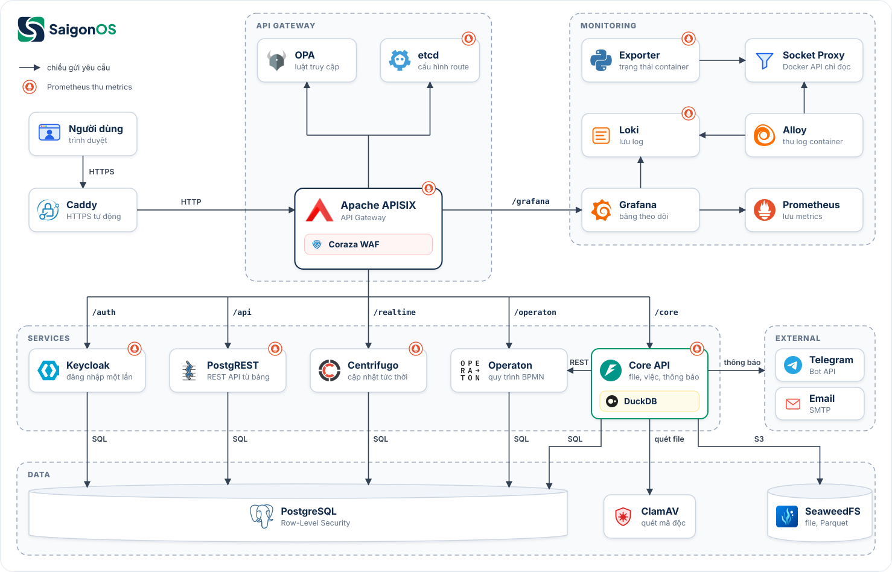

<!-- SPDX-License-Identifier: Apache-2.0 -->
<p align="center"></p>

SaigonOS là phần lõi nguồn mở của một hệ điều hành chuyển đổi số (DX-OS). Lõi cung cấp sẵn đăng nhập một lần, API Gateway, dữ liệu, kho file và quy trình. Lõi không có giao diện cho người dùng cuối. Mỗi ứng dụng chỉ viết phần nghiệp vụ và giao diện, rồi được cài đặt vào lõi bằng một lệnh.

Tài liệu của SaigonOS có ở trang web [www.saigonos.org](https://www.saigonos.org) và trong thư mục [docs](docs/README.md). Mỗi phiên bản có ở trang [Releases](https://github.com/tynnpdhsp/SaigonOS/releases). Các thay đổi được ghi trong [CHANGELOG.md](CHANGELOG.md).

## Thành phần



Caddy chỉ chạy khi triển khai lên [máy chủ chưa có reverse proxy](docs/admin/deploy.md#máy-chủ-chưa-có-reverse-proxy). Các service trong vùng MONITORING chỉ chạy khi [bật giám sát](docs/admin/monitoring.md#bật-giám-sát).

| Chức năng | Phần mềm |
|---|---|
| HTTPS và chứng chỉ tự động | Caddy |
| API Gateway, cấu hình route, luật truy cập, tường lửa ứng dụng web | APISIX, etcd, Open Policy Agent, Coraza |
| Đăng nhập một lần (Identity/SSO), mã OTP | Keycloak |
| Dữ liệu có cấu trúc, REST API, Row-Level Security, audit log | PostgreSQL, PostgREST |
| Dữ liệu phi cấu trúc, quét mã độc | SeaweedFS, ClamAV |
| Luồng công việc (Workflow) | Operaton |
| Cập nhật tức thời | Centrifugo |
| File, việc, thông báo qua Telegram và email | Core API (FastAPI) |
| Hồ dữ liệu lịch sử | DuckDB, Parquet |
| Giám sát | Prometheus, Loki, Grafana, Alloy, Exporter, Socket Proxy |

## Cài đặt

Cần Linux, Python 3.11 trở lên, Docker Engine 25.0 trở lên có Docker Compose, Git và 4 GB RAM. Máy chưa có conda thì cài Miniforge như ở trang [Cài đặt](docs/install.md).

```bash
conda create -n saigonos python=3.12
conda activate saigonos
git clone https://github.com/tynnpdhsp/SaigonOS.git
cd SaigonOS
pip install .
saigonos init
saigonos up
saigonos doctor
```

Lần chạy đầu tiên mất vài phút để tải các image. Hệ thống chạy tại http://localhost:9080. Để máy khác truy cập được hoặc để chạy trên máy chủ có tên miền, xem [Cấu hình](docs/admin/configuration.md) và [Triển khai lên máy chủ](docs/admin/deploy.md).

## Ứng dụng mẫu

Ứng dụng mẫu quản lý việc đặt phòng máy của một trường học. Ứng dụng nằm trong thư mục `examples` của repo. Do đó, lệnh sau được chạy trong thư mục `SaigonOS` đã clone ở trên, hoặc trong thư mục giải nén từ file release, với môi trường `saigonos` đang được kích hoạt:

```bash
saigonos apply examples/phong-may
```

Sau khi cài đặt, ứng dụng chạy tại http://localhost:9080/apps/phong-may/. Trang [Viết ứng dụng đầu tiên](docs/first-app.md) giải thích từng file của ứng dụng này và cách gán role cho người dùng.

## Tham gia phát triển

- Báo lỗi hoặc đề xuất tính năng: mở một [issue](https://github.com/tynnpdhsp/SaigonOS/issues/new/choose).
- Đóng góp mã nguồn: xem [CONTRIBUTING.md](CONTRIBUTING.md).
- Báo cáo lỗ hổng bảo mật: xem [SECURITY.md](SECURITY.md).

## Giấy phép

SaigonOS được phát hành theo giấy phép [Apache-2.0](LICENSE). Các phần mềm và thư viện mà SaigonOS sử dụng được liệt kê trong [DEPENDENCIES.md](DEPENDENCIES.md).
